<div align="center">

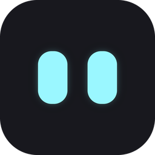

# Tokeye

**Your AI coding bill at a glance, watched over by a pair of eyes.**

Tokeye is a small tray app that tracks the tokens and cost of **Claude Code, Codex CLI, OpenCode, Gemini CLI, Cline, Roo Code, Kilo Code and Cursor**. It shows them in a notch island, a floating bubble, a desktop widget or your taskbar.

[](https://github.com/imamhossain94/tokeye/releases/latest)
[](https://github.com/imamhossain94/tokeye/releases)
[](#-install)
[](https://tauri.app)
[](https://www.rust-lang.org)

[**⬇ Download**](https://github.com/imamhossain94/tokeye/releases/latest) · [Features](#-features) · [Install](#-install) · [Build from source](#-build-from-source)

<br />

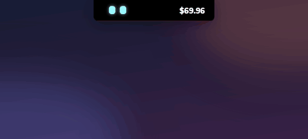

</div>

<br />

<p align="center">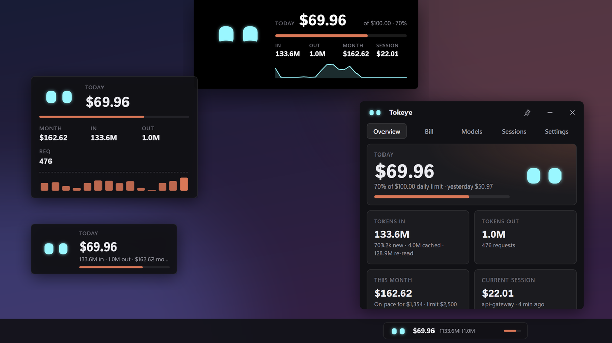</p>

<p align="center"><sub>Every screenshot here uses generated demo data (<code>scripts/demo_data.py</code>).</sub></p>

---

## ✨ Features

|  |  |
|---|---|
| 🏝️ **Notch island** | A black pill at the top of the screen that opens into a stats card on hover or click. Long-press to drag it anywhere; it can auto-hide until you touch the top edge. |
| 🫧 **Floating bubble** | An always-on-top card you can drag anywhere. Pin it to one project or session to watch just its tokens and cost. |
| 🖼️ **Desktop widget** | A bigger card with a cost chart that sits on your desktop. |
| 📏 **Taskbar strip** | Today's spend next to your clock (Windows). |
| 👀 **The companion** | Two expressive eyes that follow your cursor and react to your spending. |
| 📊 **Dashboard** | Today, month, session, tokens in/out, charts, and breakdowns by tool and provider. |
| 🧾 **Bill explorer** | Filter by provider (e.g. Vertex AI), tool, project, session or model, group, drill down, and export CSV. |
| 🗂️ **Sessions** | Every session with its cost. Click one to open the project in your editor. |
| 🚨 **Limits & alerts** | Daily, monthly and per-session limits, with notifications and visual warnings. |
| 🎨 **Customization** | Size, opacity, style, corner radius, what each surface shows, eye shape, personality, themes. |
| 🧩 **Many tools** | Claude Code, Codex CLI, OpenCode, Gemini CLI, Cline, Roo Code, Kilo Code and Cursor. |
| 🔒 **Private** | Reads local log files only (read-only). Nothing leaves your computer. |
| 🚀 **Light** | About 3 MB to install, starts with your computer, runs on Windows, macOS and Linux. |

---

## 🏝️ Notch island

A small island that hangs from the top of your screen, inspired by Apple's Dynamic Island.

<table>
<tr>
<td align="center" width="33%">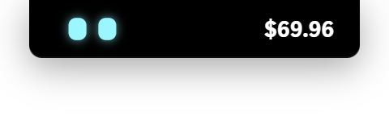<br /><sub><b>Collapsed:</b> eyes and today's cost</sub></td>
<td align="center" width="33%">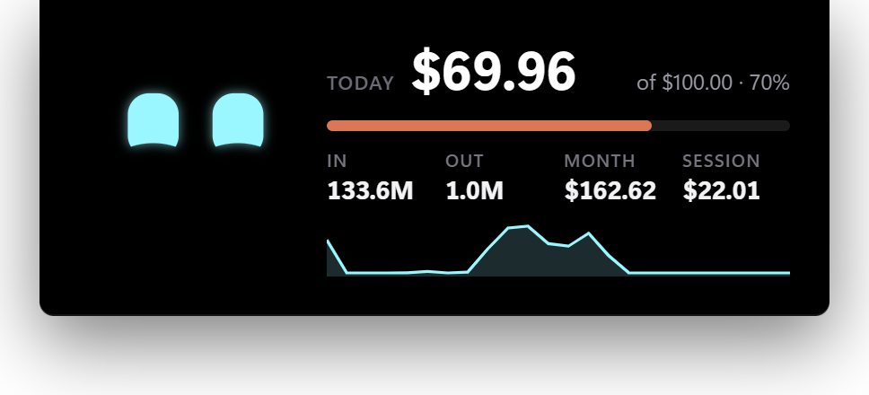<br /><sub><b>Hover:</b> limit, tokens, month, session, hourly chart</sub></td>
<td align="center" width="33%">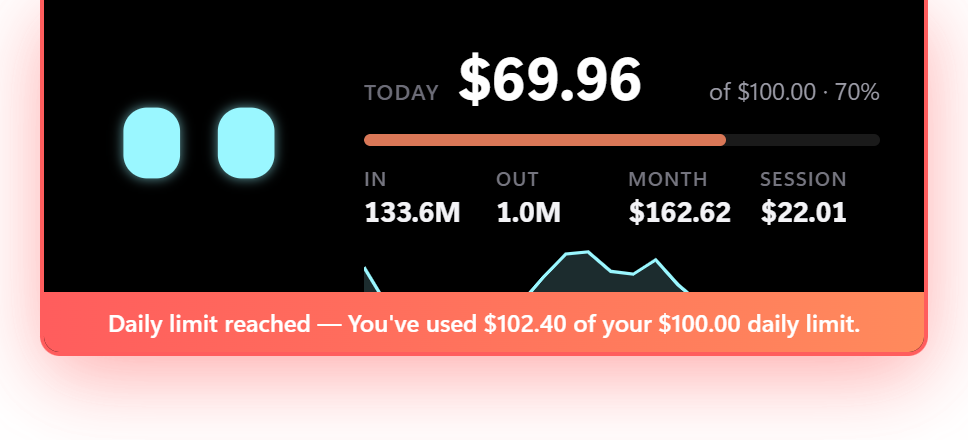<br /><sub><b>Alert:</b> a red banner when you hit a limit</sub></td>
</tr>
</table>

- **Clicks pass through** everywhere except the pill itself, so it never gets in your way.
- **Opens your way:**
  - **on hover** (the default): click it to open the dashboard;
  - **on click:** click again to close it, double-click to open the dashboard;
  - **never.**
- **Move it:** long-press the notch, then drag it anywhere.
  - Drop it near the top and it snaps flush to the edge. Anywhere else it gets rounded corners.
  - Pick a position in Settings to send it home.
- **Auto-hide:** after 5 s, 10 s, 30 s, 1, 5, 15 or 30 minutes, or an hour without the pointer, it slides up out of sight.
  - Touch the top edge of the screen to bring it back: anywhere on the edge, or only above the notch.
  - Limit alerts bring it back too.
- **Pulses** amber near a limit and red when you're over one.
- **Configurable:** position (top left, center, right, or wherever you dragged it), size, style, radius, and which values it shows.

## 🫧 Bubble, 🖼️ widget and 📏 taskbar strip

<table>
<tr>
<td align="center" width="38%">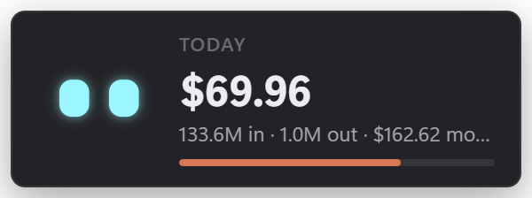<br /><sub><b>Floating bubble:</b> drag it anywhere; it stays on top</sub></td>
<td align="center" width="36%">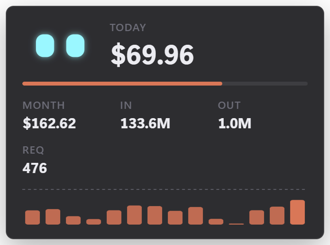<br /><sub><b>Desktop widget:</b> sits on the desktop, with a 7, 14 or 30-day chart</sub></td>
<td align="center" width="26%">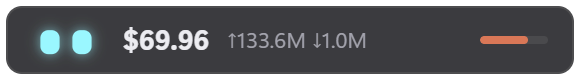<br /><sub><b>Taskbar strip:</b> next to the clock, with tokens in and out</sub></td>
</tr>
</table>

<table>
<tr>
<td align="center" width="55%">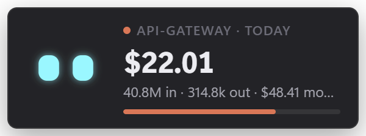<br /><sub><b>Pinned to a project:</b> its cost, tokens in and tokens out</sub></td>
<td align="center" width="45%">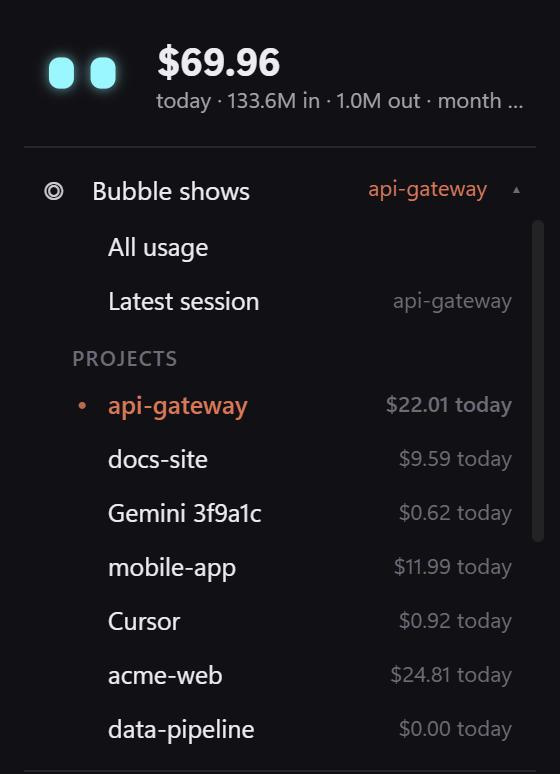<br /><sub><b>Right-click → Bubble shows:</b> pick what it counts</sub></td>
</tr>
</table>

- **Pin it to a project or session:** right-click the bubble → **Bubble shows**, then pick one of these:
  - a project;
  - a session;
  - **Latest session**, which follows whatever you're working on.

  Its cost and tokens in/out then replace the totals, and a dot by the label shows it's pinned. Every surface can be pinned like this, from its own menu or from **Settings → Surfaces → Shows**. The **◉** button on a session in the Sessions tab pins that session to the bubble.
- **Auto-hide** works on every surface. It fades out after the time you choose and comes back when you touch the top edge of the screen.
- **Show any mix:** turn on as many surfaces as you like. Positions are remembered.
- **Mouse:** right-click any surface for the menu; double-click it to open the dashboard.
- **Click-through mode** for the bubble and widget lets them float over your work without catching clicks. Turn it off from the tray menu.

## 👀 The companion

<table>
<tr>
<td width="44%" align="center">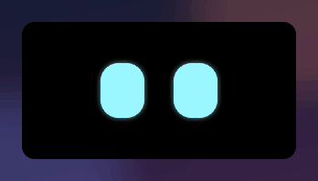</td>
<td width="56%" align="center">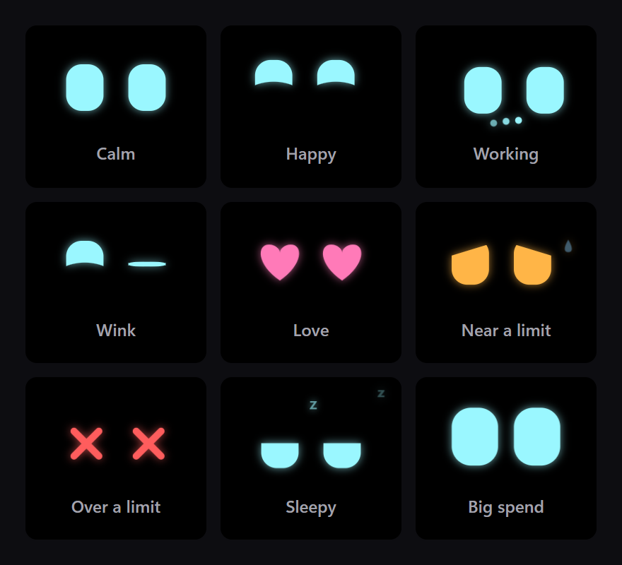</td>
</tr>
</table>

| It… | When |
|---|---|
| blinks, glances around, and **follows your cursor** anywhere on screen | always |
| looks **busy** (typing dots) and hops each time the cost ticks up | while your AI tool is generating |
| looks **shocked** | a single jump of $1 or more |
| looks **worried** (amber, sweat drop) | you're past your warning threshold |
| goes **dizzy** (red ✕ eyes) | you're over a limit |
| falls **asleep** (z z z) | 20 minutes without activity, until you move the mouse near it |
| **winks** and boops | you click it |
| gets **heart eyes** | you double-click it |
| **giggles** | you wiggle the mouse over it ("petting") |

Choose the eye shape (rounded, round, tall, wide, square, dots), the personality (calm, normal, playful), the eye color, and whether it follows your cursor.

## 📊 Dashboard

Left-click the tray icon to open the dashboard as a flyout. Pin it to keep it open.

<table>
<tr>
<td align="center" width="50%">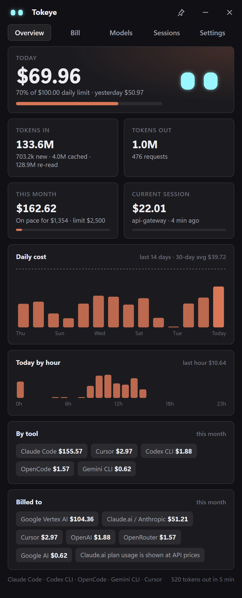<br /><sub>Overview (dark)</sub></td>
<td align="center" width="50%">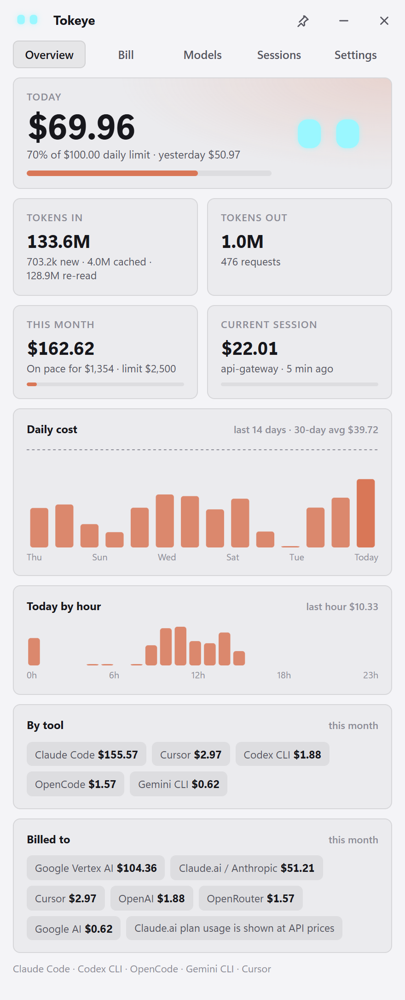<br /><sub>Overview (light)</sub></td>
</tr>
</table>

- **Today:** cost, progress toward your daily limit, and yesterday for comparison.
- **Tokens in** (new, cache writes, cache re-reads) and **tokens out**, plus request and web-search counts.
- **This month:** cost to date, a month-end projection, and progress toward your monthly limit.
- **Current session:** cost and project of the session you're in right now.
- **Charts:** daily cost for the last 14 days (with your limit line) and today by hour.
- **By tool and billed to:** see where the money goes, e.g. Claude Code vs. Codex, or Vertex AI vs. a Claude.ai plan.

## 🧾 Bill

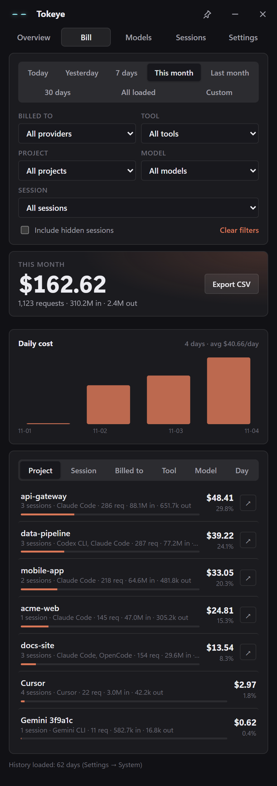

The Bill tab answers *"what did this cost, and where did it go?"*

- **Period:** today, yesterday, 7 days, this month, last month, 30 days, everything loaded, or custom dates.
- **Filters:** **billed to** (Google Vertex AI, Claude.ai / Anthropic, OpenAI, OpenRouter, Cursor and others), **tool**, **project**, **model** and **session**. Each list shows only what's available given the other filters, with the cost of each option.
- **Group by:** project, session, provider, tool, model or day, with each row's share of the total.
- **Drill down** by clicking a row: project → its sessions → their models, or a day → its sessions.
- **Open in editor** with ↗ on project and session rows.
- **Export CSV:** one line item per day, tool, provider, project, session and model, with token counts and cost, plus a total row. Saved to your Downloads folder.
- **Hidden sessions** stay out of the bill unless you include them.

<br clear="right" />

## 🗂️ Sessions and 🤖 models

<table>
<tr>
<td align="center" width="50%">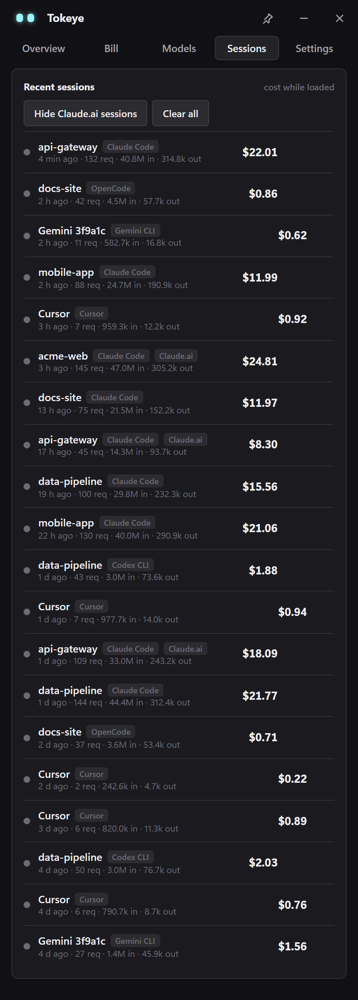<br /><sub>Sessions</sub></td>
<td align="center" width="50%">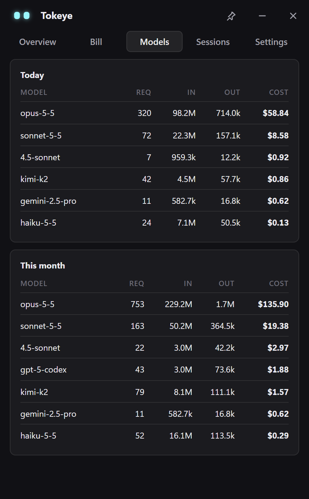<br /><sub>Models</sub></td>
</tr>
</table>

- **◉ Pin** a session to the floating bubble to watch it live.
- **Open a project:** click a session to open its folder in **your editor**: VS Code, Cursor, Windsurf, VS Code Insiders, Zed, Sublime Text, JetBrains, the file manager, or any custom command with `{path}`.
- **Clean up:**
  - **×** hides a session.
  - **Hide Claude.ai sessions** hides everything from a personal Claude.ai account.
  - **Clear all** starts counting fresh from now.
  - **Restore** brings everything back.
  - Your tools' files are never touched.
- **Models:** requests, tokens and cost for each model, today and this month.

## 🚨 Limits and alerts

- **Limits:** set a **daily**, **monthly** and **per-session** limit (0 turns one off), and a warning threshold (80% by default).
- **What happens when you cross one:**
  - a desktop notification;
  - a red banner on the notch;
  - the companion's mood changes;
  - the tray icon turns amber or red.
- **No spam:** each warning fires once per day, month or session.

## 🖱️ Tray and custom menu

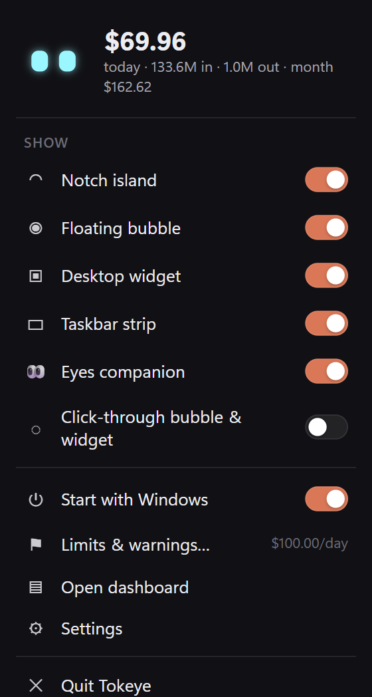

- **Left-click** the tray icon to open the dashboard flyout.
- **Right-click** for Tokeye's own styled menu:
  - today's total;
  - what the surface you right-clicked shows (all usage, the latest session, a project or a session);
  - switches for each surface and the companion;
  - click-through;
  - start with Windows or at login;
  - limits, dashboard and settings shortcuts.
- **Hover** for a tooltip with today's and this month's cost.
- **macOS:** today's cost also appears next to the menu-bar icon.

<br clear="right" />

## ⚙️ Settings and customization

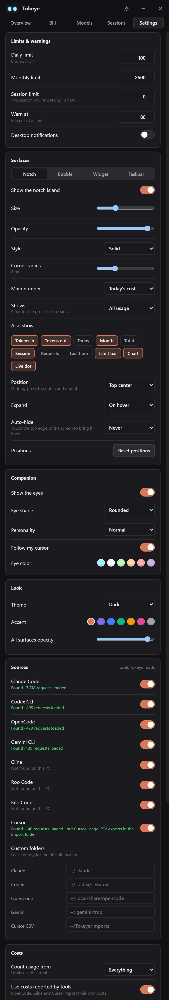

**For each surface** (notch, bubble, widget, taskbar strip):
- size (60–200%) and opacity;
- style: solid, glass, outline or minimal;
- corner radius (0–30 px; default 8 px, like File Explorer);
- what it shows: all usage, the latest session, one project or one session;
- the main number: today, month, total, session, last hour, tokens in, tokens out or requests;
- extra values: tokens in/out, today, month, total, session, requests, last hour, limit bar, chart, live dot;
- auto-hide (5 s to 1 hour), and where touching the top edge brings the notch back;
- notch position (or drag it), and expand on hover, on click or never;
- bubble/widget on-top and click-through;
- widget chart range.

**Companion:** eye shape, personality, eye color, follow cursor.

**Look:** system, dark or light theme; accent color; overall opacity.

**Sources:** turn each tool on or off, see whether it was found, and override any data folder.

**Costs:**
- count everything or a single provider (for example only **Google Vertex AI**, to track an office bill);
- use the costs that tools report themselves;
- an editable **price table** (per 1M tokens; first matching model pattern wins);
- web-search price and currency symbol.

**System:** code editor, start with your computer, refresh interval, and how many days of history to load.

<br clear="right" />

## 🧩 Supported tools

| Tool | Data Tokeye reads (read-only) | Cost |
|---|---|---|
| **Claude Code** | `~/.claude/projects/**/*.jsonl` (or `$CLAUDE_CONFIG_DIR`) | price table; Vertex AI and Bedrock detected automatically |
| **Codex CLI** | `~/.codex/sessions/**/*.jsonl` (or `$CODEX_HOME`) | price table |
| **OpenCode** | `~/.local/share/opencode/opencode.db` (SQLite), or the older `storage/message/*.json` | reported by OpenCode |
| **Gemini CLI** | `~/.gemini/tmp/*/chats/*.json` | price table |
| **Cline, Roo Code, Kilo Code** | each extension's `tasks/*/ui_messages.json` in VS Code, Cursor, Windsurf, VSCodium, Trae, Kiro or Void | reported by the extension |
| **Cursor** | Cursor keeps no token counts on disk. Export your usage CSV (cursor.com → Usage → Export) into `~/Tokeye/imports/` | from the CSV |

The default price table covers Claude (Opus, Sonnet, Haiku and Fable), OpenAI GPT and o-series, Gemini, DeepSeek, Grok, Kimi, GLM, Qwen and MiniMax. Every price can be edited. Costs are list-price estimates, and your provider's invoice is the final word. Claude.ai plan usage is shown at API prices for comparison.

## 📦 Install

Download the file for your system from the **[latest release](https://github.com/imamhossain94/tokeye/releases/latest)**.

| System | File | How |
|---|---|---|
| **Windows 10/11** | `Tokeye_x.y.z_x64-setup.exe` | Run the installer (no admin rights needed). An `.msi` is also available. |
| **Ubuntu / Debian** | `Tokeye_x.y.z_amd64.deb` | `sudo apt install ./Tokeye_x.y.z_amd64.deb` |
| **Any Linux** | `Tokeye_x.y.z_amd64.AppImage` | `chmod +x Tokeye_*.AppImage && ./Tokeye_*.AppImage` |
| **Fedora / RHEL** | `Tokeye-x.y.z-1.x86_64.rpm` | `sudo dnf install ./Tokeye-*.rpm` |
| **macOS 10.15+** (Apple Silicon and Intel) | `Tokeye_x.y.z_universal.dmg` | Open it and drag Tokeye to Applications. |

> [!NOTE]
> The builds aren't code-signed yet.
> - **Windows:** if SmartScreen appears, click **More info → Run anyway**.
> - **macOS:** right-click Tokeye → **Open** the first time, or run `xattr -dr com.apple.quarantine /Applications/Tokeye.app`.

After installing:
- **Startup:** Tokeye starts with your computer, which you can turn off in Settings.
- **First launch:** it opens the dashboard; after that it lives in the tray.
- **Linux:**
  - **Tray:** needs a desktop that supports AppIndicator (GNOME with the AppIndicator extension, KDE and others). Transparent surfaces need a compositor.
  - **Wayland:** Tokeye runs through XWayland so its surfaces can position themselves and stay on top. Set `GDK_BACKEND=wayland` to opt out.
  - **AppImage:** needs FUSE 2: `sudo apt install libfuse2` (`libfuse2t64` on Ubuntu 24.04 and later).
  - **Blank windows:** Tokeye turns off WebKitGTK's DMA-BUF renderer, which leaves windows blank on many NVIDIA and virtual GPUs. Set `WEBKIT_DISABLE_DMABUF_RENDERER=0` to use it anyway.

## 🔒 Privacy

- **Local only:** Tokeye only **reads** the log files your AI tools already write on your machine.
- **No uploads:** it has no account, no telemetry and no network calls for your data.
- **Your settings** stay in your user config folder:
  - Windows: `%APPDATA%\app.tokeye.monitor`
  - macOS: `~/Library/Application Support/app.tokeye.monitor`
  - Linux: `~/.config/app.tokeye.monitor`

## 🛠 Build from source

You need [Rust](https://rustup.rs) (stable), [Node.js](https://nodejs.org) 18+, and the [Tauri prerequisites](https://tauri.app/start/prerequisites/) for your system:
- **Windows:** WebView2 and the MSVC build tools.
- **macOS:** Xcode command-line tools.
- **Linux:** `libwebkit2gtk-4.1-dev libayatana-appindicator3-dev librsvg2-dev`.

```bash
git clone https://github.com/imamhossain94/tokeye.git
cd tokeye
npm install
npx tauri build          # installers in src-tauri/target/release/bundle/
# or, for just the app:
cd src-tauri && cargo build --release
```

The UI is plain HTML, CSS and JavaScript in `ui/`, embedded at build time. There's no bundler and no framework.

```
src-tauri/src/main.rs      tray, windows, limits and alerts, autostart, commands
src-tauri/src/engine.rs    readers for every tool, statistics, the bill explorer, CSV export
src-tauri/src/settings.rs  settings, surfaces, price table
ui/index.html              dashboard: overview, bill, models, sessions, settings
ui/overlay.html            notch, bubble, widget and taskbar strip (picked by window label)
ui/menu.html               custom tray menu
ui/js/eyes.js              the companion: moods, blinking, gaze, particles
scripts/                   icon generator, demo data, screenshot/GIF capture
.github/workflows/         release builds for Windows, Linux and macOS
```

### Releasing

Bump `version` in `src-tauri/tauri.conf.json` (and `package.json`), then push a tag:

```bash
git tag vX.Y.Z && git push origin vX.Y.Z
```

GitHub Actions builds Windows (`.exe`, `.msi`), Linux (`.deb`, `.AppImage`, `.rpm`) and macOS (universal `.dmg`) and publishes the release.

### Regenerating the screenshots

```bash
python scripts/demo_data.py demo-data                # fake usage for every tool
# point Tokeye at demo-data (see the script header), start it with
# WEBVIEW2_ADDITIONAL_BROWSER_ARGUMENTS=--remote-debugging-port=9333, then:
node scripts/capture.mjs docs/images shots
node scripts/capture.mjs docs/images gif-notch
node scripts/capture.mjs docs/images gif-eyes
python scripts/make_media.py docs/images
```

## ⚠️ Known limitations

- **macOS notch:** the island sits just below the menu bar, not over it.
- **Wayland:** Tokeye only sees the cursor over its own windows and X11 apps. The eyes may stop following it, and a hidden notch comes back when you touch the top edge above it.
- **Windows taskbar strip:** it floats above the taskbar, putting itself back on top a few times a second. It isn't embedded in the taskbar.
- **Not yet tested with real logs:** the Codex, Gemini CLI, Cline-family and Cursor CSV readers follow each tool's log format. Please open an issue if numbers look off.

---

<div align="center">
<sub>Made with 🦀 Rust, Tauri and a lot of tokens.</sub>
</div>
